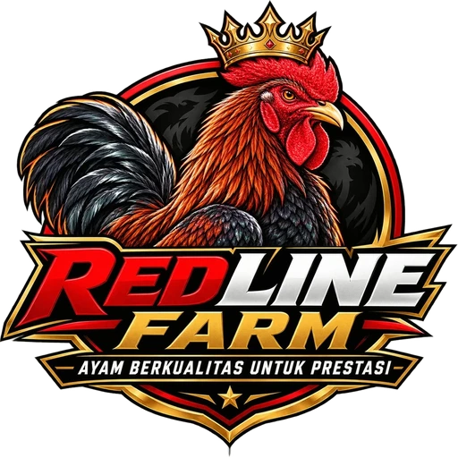
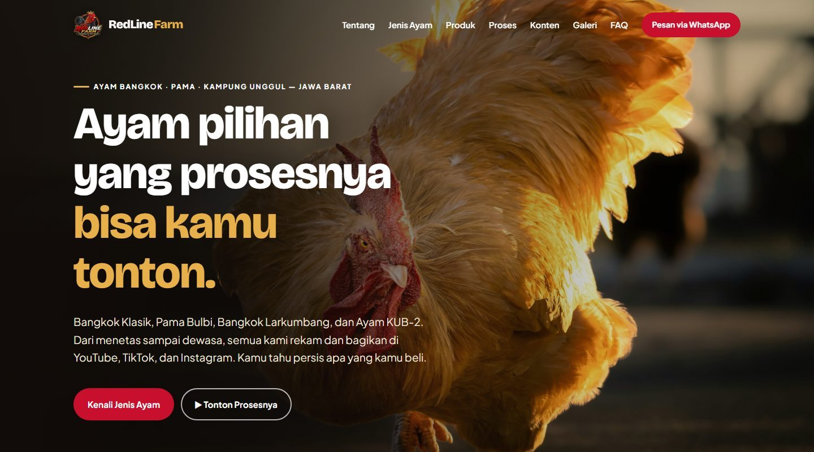

<p align="center">
  
</p>

<h1 align="center">RedLine Farm</h1>

<p align="center">
  Website peternakan ayam <b>Bangkok Klasik</b>, <b>Bangkok Larkumbang</b>, <b>Pama Bulbi</b>, dan <b>Ayam KUB-2</b>.<br>
  Ayam berkualitas untuk prestasi: laga, hias &amp; bibit.
</p>

<p align="center">
  <a href="https://GamaSatria.github.io/RedLine-Farm-Website/"><b>🌐 Lihat Demo</b></a>
</p>



## Jenis ayam

| Jenis | Kegunaan |
|---|---|
| Bangkok Klasik | Khusus laga &amp; bibit |
| Bangkok Larkumbang | Laga, hias &amp; bibit |
| Pama Bulbi | Laga, hias &amp; bibit |
| Ayam KUB-2 | Pedaging &amp; petelur |

## Fitur

- Responsif, nyaman dibuka di HP maupun desktop
- Tab jenis ayam dengan detail ciri dan harga, plus tabel perbandingan
- Tombol pemesanan langsung ke WhatsApp dengan pesan otomatis
- Galeri, konten video, testimoni, dan FAQ
- Tanpa framework dan tanpa proses build: cukup HTML, CSS, dan JavaScript

## Menjalankan di komputer

Jalankan server lokal dari folder proyek:

```bash
python -m http.server 8080
```

lalu buka http://localhost:8080

> Jangan membuka `index.html` dengan klik dua kali. Beberapa browser tidak memuat semua aset dengan benar kalau dibuka langsung dari file.

---

# Panduan mengelola isi

Website statis (HTML + CSS + JS). Tidak perlu build, tinggal upload ke GitHub Pages / Vercel / Netlify.


## Struktur

```
index.html          ← semua teks & isi halaman
css/style.css       ← tampilan (warna brand ada di bagian :root paling atas)
js/main.js          ← nomor WA & link sosmed (bagian CONFIG paling atas)
assets/img/logo-redline.webp       ← logo
assets/img/banner-redline.webp     ← banner promo
assets/img/         ← semua foto
```

## Cara ganti foto

Timpa file di `assets/img/` dengan foto asli **memakai nama file yang sama**:

| File | Dipakai di | Saran ukuran |
|---|---|---|
| `banner-redline.webp` | Banner promo di bawah hero | 1600×600 |
| `logo-redline.webp` | Logo di header, footer, ikon tab | 512×512, latar transparan |
| `hero.jpg` | Foto besar paling atas | 1800px lebar, landscape |
| `tentang-kami.jpg` | Bagian "Cerita Kami" | 1200px, portrait / 4:5 |
| `jenis-bangkok-klasik.jpg` | Tab "Bangkok Klasik" di bagian Jenis Ayam | 1000px, 4:5 / kotak |
| `jenis-pama-bulbi.jpg` | Tab "Pama Bulbi" | 1000px, 4:5 / kotak |
| `jenis-bangkok-larkumbang.jpg` | Tab "Bangkok Larkumbang" | 1000px, 4:5 / kotak |
| `jenis-kub-2.jpg` | Tab "Ayam KUB-2" | 1000px, 4:5 / kotak |
| `produk-ayam-kampung.jpg` | Kartu produk 1 | 900px, 4:3 |
| `produk-telur.jpg` | Kartu produk 2 | 900px, 4:3 |
| `produk-doc.jpg` | Kartu produk 3 | 900px, 4:3 |
| `produk-pejantan.jpg` | Kartu produk 4 | 900px, 4:3 |
| `konten-1.jpg` … `konten-3.jpg` | Thumbnail video (konten-2 = video besar YouTube) | 900px |
| `galeri-1.jpg` … `galeri-6.jpg` | Galeri | 1000px |

Usahakan setiap foto di bawah 300 KB (kompres di squoosh.app atau tinypng.com) supaya web tetap cepat.

## Cara ganti info

1. **Nomor WhatsApp & sosmed** → buka `js/main.js`, ubah bagian `CONFIG`. Semua tombol "Pesan" otomatis ikut berubah.
   Nomor WA juga tertulis di bagian Kontak di `index.html` (cari `+62 812-3456-7890`).
2. **Teks, harga, testimoni, FAQ, alamat** → edit langsung di `index.html` (setiap bagian diberi komentar `<!-- ===== NAMA BAGIAN ===== -->`).
3. **Data jenis ayam** (bobot, warna bulu, harga per jenis, tabel perbandingan) → `index.html`, bagian `<!-- ===== JENIS AYAM ===== -->`.
   Angkanya masih contoh dari referensi umum (KUB-2: BSIP/Balitbangtan & SNI 8405:2023; Bangkok/Pama/Larkumbang: referensi penghobi).
   Foto `jenis-*.jpg` belum ada. Selama belum diisi, yang tampil adalah kotak warna bulu, jadi web tetap rapi.
4. **Angka statistik** → di `index.html`, ubah nilai `data-count="..."`.
5. **Peta lokasi** → di `index.html`, ganti `q=Bandung` pada iframe peta dengan alamat kandang,
   atau tempel kode embed dari Google Maps (Bagikan → Sematkan peta).
6. **Warna brand** → `css/style.css`, bagian `:root` (`--red`, `--straw`, dst).

## Kredit foto contoh

Semua foto contoh dari Unsplash (lisensi Unsplash, gratis dipakai). Tetap disarankan diganti dengan foto asli kandang.
